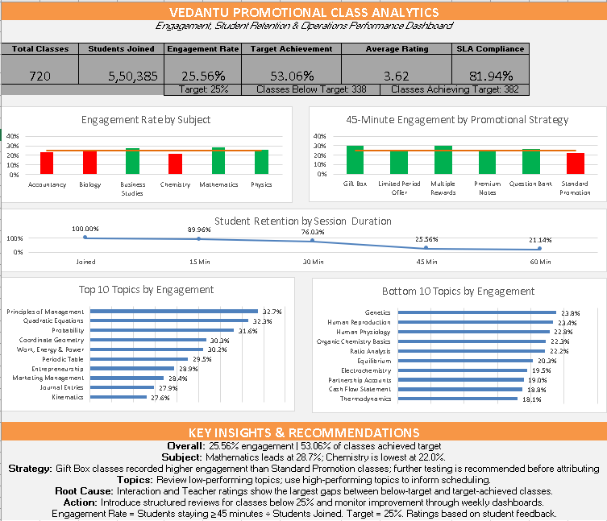

# Vedantu Promotional Class Analytics

## Engagement, Student Retention & Operations Dashboard

<figure>

<figcaption aria-hidden="true">Excel Dashboard</figcaption>
</figure>

## Project Overview

This project analyzes promotional/free classes in an EdTech environment
to understand student engagement, retention, teacher and subject
performance, promotional strategy performance, student feedback, and
operational SLA compliance.

The project uses **MySQL** for data validation and business analysis and
**Microsoft Excel** for dashboarding and executive reporting.

> **Dataset note:** This is a simulated/anonymized portfolio dataset
> created based on an EdTech promotional-class operations workflow. It
> contains no confidential company or student data.

## Business Problem

Promotional classes help attract students and introduce paid learning
offerings. However, not every class achieves the desired level of
engagement.

The analysis answers:

- How many students attend and remain engaged?
- Which subjects and topics perform better or worse?
- Which teachers perform above or below their subject benchmark?
- Which promotional strategies have higher observed engagement?
- At what point do students drop out of a 60-minute class?
- Which student-rating dimensions differ between target-achieving and
  below-target classes?
- How do operational SLA issues relate to class performance?
- Which classes require deeper investigation?

**Business engagement benchmark:** 25%.

**Engagement definition:** students staying at least 45 minutes divided
by students joined.

## Project Objectives

1.  Measure overall promotional-class engagement.
2.  Evaluate subject and topic performance.
3.  Analyze teacher-level performance.
4.  Benchmark teachers against their subject average.
5.  Compare promotional strategies.
6.  Analyze retention at 15, 30, 45 and 60 minutes.
7.  Identify the largest retention drop-off.
8.  Compare student ratings across engagement groups.
9.  Analyze operational SLA compliance.
10. Build an actionable Excel dashboard.

## Dataset

| Table                 | Records | Purpose                           |
|-----------------------|--------:|-----------------------------------|
| subjects              |       6 | Subject master data               |
| topics                |      36 | Topic and difficulty information  |
| teachers              |      24 | Teacher information               |
| promotionalstrategies |       6 | Promotional strategy definitions  |
| classes               |     720 | Main class-level performance data |
| classoperations       |     720 | SME/deck SLA and operations       |
| engagementmilestones  |     720 | Student retention milestones      |
| classratings          |   3,600 | Rating-level data                 |
| classreviews          |     338 | Below-target review/action data   |

## Data Model

``` text
Subjects
   │
   └── Topics
          │
Teachers ─┴── Classes ─── PromotionalStrategies
              │
              ├── ClassOperations
              ├── EngagementMilestones
              ├── ClassRatings
              └── ClassReviews
```

## Tools

- MySQL
- SQL
- Microsoft Excel

## Key KPIs

| KPI                     |        Result |
|-------------------------|--------------:|
| Total Classes           |       **720** |
| Students Joined         |   **550,385** |
| Students Engaged        |   **140,664** |
| Overall Engagement Rate |    **25.56%** |
| Target Achieved Classes | **382 / 720** |
| Target Achievement Rate |    **53.06%** |
| Attendance Rate         |    **72.07%** |
| Average Student Rating  |  **3.62 / 5** |
| Rating Response Rate    |    **18.15%** |
| Overall SLA Compliance  |    **81.94%** |

## Key Findings

### 1. Subject Performance

| Subject          | Engagement |
|------------------|-----------:|
| Mathematics      |  **28.7%** |
| Business Studies |  **27.5%** |
| Physics          |  **26.2%** |
| Biology          |  **24.7%** |
| Accountancy      |  **23.2%** |
| Chemistry        |  **22.0%** |

Mathematics recorded the highest observed engagement at 28.7%, while
Chemistry recorded the lowest at 22.0%.

### 2. Promotional Strategy

| Strategy             | Engagement |
|----------------------|-----------:|
| Gift Box             |  **30.2%** |
| Multiple Rewards     |  **29.5%** |
| Question Bank        |  **26.6%** |
| Limited Period Offer |  **25.9%** |
| Premium Notes        |  **25.2%** |
| Standard Promotion   |  **22.0%** |

Gift Box classes recorded 30.2% engagement versus 22.0% for Standard
Promotion, an observed difference of 8.2 percentage points.

This is an observed association, not proof of causation. A controlled
experiment would be required to establish causal impact.

### 3. Student Retention

| Milestone  |   Retention |
|------------|------------:|
| Joined     | **100.00%** |
| 15 Minutes |  **89.96%** |
| 30 Minutes |  **76.03%** |
| 45 Minutes |  **25.56%** |
| 60 Minutes |  **21.14%** |

The largest drop-off occurred between 30 and 45 minutes. Approximately
66.38% of students who reached 30 minutes did not reach the 45-minute
engagement threshold.

### 4. Root-Cause Indicators

| Rating Dimension | Below Target | Target Achieved |       Gap |
|------------------|-------------:|----------------:|----------:|
| Interaction      |         3.39 |            3.78 | **+0.39** |
| Teacher          |         3.56 |            3.90 | **+0.34** |
| Overall          |         3.49 |            3.74 |     +0.25 |
| Content          |         3.51 |            3.75 |     +0.24 |
| Topic Relevance  |         3.47 |            3.64 |     +0.17 |
| Promotion        |         3.50 |            3.61 |     +0.11 |

Interaction and Teacher ratings showed the largest observed gaps and
were therefore treated as priority areas for investigation.

### 5. Operations & SLA

| Performance Group | SLA Compliance |
|-------------------|---------------:|
| Target Achieved   |     **83.77%** |
| Below Target      |     **79.88%** |

Among 338 below-target classes, 68 had an overall SLA breach,
representing a 20.12% breach rate.

| SLA Type | Breach Rate |
|----------|------------:|
| SME SLA  |  **10.56%** |
| Deck SLA |   **8.19%** |

### 6. Teacher Benchmarking

Teachers were compared with the average engagement rate of the subject
they taught. This helps distinguish teacher-level performance from
broader subject-level patterns.

Teachers with at least five classes were used for benchmarking to reduce
small-sample interpretation.

### 7. Monthly Performance

| Month    | Engagement | Target Achievement | SLA Compliance |
|----------|-----------:|-------------------:|---------------:|
| Jan-2026 |     25.28% |             49.57% |         76.07% |
| Feb-2026 |     25.98% |             54.39% |         81.58% |
| Mar-2026 |     24.95% |             50.50% |         84.16% |
| Apr-2026 |     24.80% |             52.38% |         80.16% |
| May-2026 |     25.75% |             50.71% |         83.57% |
| Jun-2026 | **26.46%** |         **60.66%** |     **86.07%** |

Engagement remained close to the 25% benchmark, while SLA compliance
improved from 76.07% in January to 86.07% in June.

## Recommendations

1.  Investigate the 30–45 minute retention window for content
    transitions, interaction, teaching delivery, topic difficulty and
    promotional timing.
2.  Prioritize interaction improvements using polls, questions, quizzes
    and participation checkpoints.
3.  Review teaching delivery in below-target classes, including pace,
    clarity, examples and participation.
4.  Review low-performing topics for content clarity, difficulty and
    relevance.
5.  Further test staged-reward promotions such as Gift Box using
    controlled experiments.
6.  Strengthen weekly SLA monitoring for SME and final-deck readiness.

## Dashboard

The Excel dashboard provides an executive view of:

- Overall KPIs
- Engagement by subject
- Student retention
- Promotional strategy engagement
- Top and bottom topics
- Key insights and recommended actions

## SQL Analysis

The MySQL script is organized into:

``` text
01. KPI Analysis
02. Subject Analysis
03. Topic Analysis
04. Teacher Analysis
05. Promotional Strategy Analysis
06. Retention Analysis
07. Root-Cause Analysis
08. Operations & SLA Analysis
09. Time-Based Analysis
10. Teacher Benchmarking
11. Project Validation
```

The analysis demonstrates joins, aggregation, conditional logic,
subqueries, segmentation, benchmarking, retention calculations, SLA
analysis and data-quality validation.

## Data Validation

Validation covered:

- Expected row counts
- Duplicate IDs
- Missing key values
- Foreign-key relationships
- Engagement-rate consistency
- Target-status consistency
- SLA values

## Project Structure

``` text
Vedantu-Class-Engagement-Analytics/
│
├── README.md
├── SQL/
│   └── Vedantu_Class_Engagement_Analytics.sql
├── Excel/
│   └── Vedantu_Engagement_Dashboard.xlsx
├── Data/
│   └── Vedantu_Class_Analytics.xlsx
└── Screenshots/
    └── Dashboard.png
```

## Business Impact

The analysis creates a structured workflow:

``` text
Class Performance
       ↓
Identify Below-Target Classes
       ↓
Analyze Retention & Ratings
       ↓
Review Teacher / Topic / Promotion
       ↓
Check Operational SLA
       ↓
Prioritize Deep-Dive
       ↓
Recommend Action
       ↓
Monitor Future Performance
```

## Skills Demonstrated

**SQL / MySQL:** data modeling, joins, aggregation, conditional logic,
subqueries, KPI development, segmentation, benchmarking, retention
analysis, root-cause analysis and data validation.

**Excel:** dashboard development, KPI cards, conditional formatting,
data visualization, target benchmarking, retention funnel and executive
reporting.

**Business Analytics:** KPI definition, student engagement analysis,
teacher benchmarking, promotional strategy analysis, SLA analysis and
action-oriented recommendations.

## Author

**Manjunath JS**

Data Analytics Portfolio Project

**Tools:** MySQL \| SQL \| Microsoft Excel \| Data Visualization
